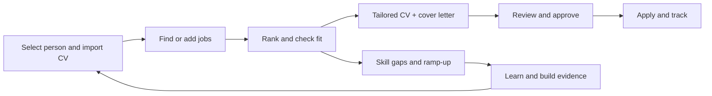
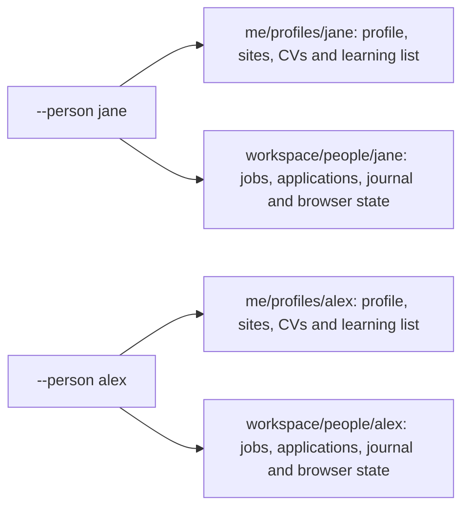
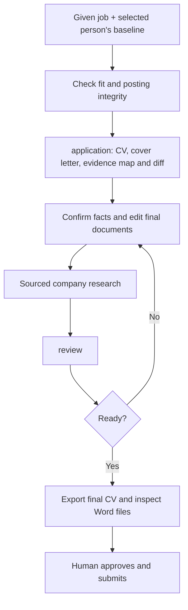
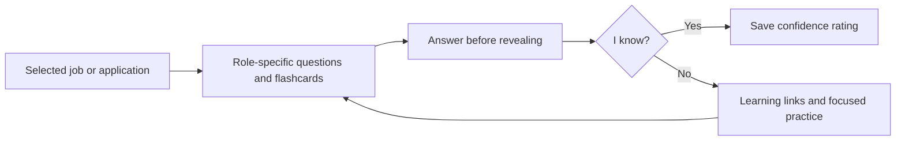

# job-hunt-agent 🧭

A **local job-hunt assistant** you run from a terminal or drive through **Claude Code, ChatGPT via Codex,
Gemini CLI, or GitHub Copilot**.
It finds jobs, ranks them, compares them to your CV, tells you what to learn, helps you rewrite your CV and apply,
and keeps a timestamped record of everything — all on your own machine.

> **No API keys or accounts are required.** Everything optional (phone notifications, Teams/Slack) is one line in `.env`.
> This applies to the standalone CLI. AI platforms require their own authentication and may require a paid plan;
> files shared with an AI assistant are subject to that provider's data policies.



Start with the quick start below, or see [step-by-step workflows with detailed diagrams](docs/workflows.md).

---

## Contents
1. [Quick start (10 minutes)](#1-quick-start-10-minutes)
2. [What you need to fill in](#2-what-you-need-to-fill-in)
   - [Multiple people and CV-derived profiles](#multiple-people-and-cv-derived-profiles)
3. [Your CV — format, import and export](#3-your-cv--format-import-and-export)
4. [Daily workflow](#4-daily-workflow)
5. ["I found a job myself" — add, check, apply](#5-i-found-a-job-myself--add-check-apply)
   - [Ramp-up: learn the skills you're missing](#5b-ramp-up--turn-missing-skills-into-a-learning-path)
6. [All commands](#6-all-commands)
7. [Where your data lives](#7-where-your-data-lives)
8. [Notifications](#8-notifications)
9. [Using it with Copilot / agents](#9-using-it-with-copilot--agents)
   - [Install and use Claude, ChatGPT/Codex, Gemini and Copilot](docs/platforms.md)
10. [Guardrails](#10-guardrails)
11. [Troubleshooting](#11-troubleshooting)
12. [Development](#12-development)

---

## 1. Quick start (10 minutes)

You need **git** and either **[uv](https://docs.astral.sh/uv/)** (recommended — it installs Python for you) or
**Python 3.10+** with pip. Pick one path; they do the same thing.

### Option A — uv (recommended)

Install uv once: Windows `winget install --id=astral-sh.uv -e` (or `powershell -c "irm https://astral.sh/uv/install.ps1 | iex"`),
macOS/Linux `curl -LsSf https://astral.sh/uv/install.sh | sh`.

```bash
git clone https://github.com/DonOzone/job-hunt-agent.git && cd job-hunt-agent
uv sync --all-extras                    # creates .venv with the exact locked versions (uv.lock)
uv run playwright install chromium      # only for the apply assistant / browser sources
uv run jobhunt init                     # creates config/profile.yaml, config/sites.yaml and .env
uv run jobhunt cv-import "C:\path\to\My CV.docx" --populate-profile  # or ~/Documents/my-cv.docx
uv run jobhunt doctor                   # tells you exactly what is still missing
uv run jobhunt daily
```

No activation needed: prefix every command with `uv run` (e.g. `uv run jobhunt list`). Prefer a bare `jobhunt` command
from any folder? `uv tool install ".[all]"` — then run it from the project folder, because `config/`, `me/` and
`workspace/` are relative to where you run it (or set `JOBHUNT_HOME` in `.env`). Update later with `git pull && uv sync --all-extras`.

### Option B — pip + venv

**Windows (PowerShell)**
```powershell
git clone https://github.com/DonOzone/job-hunt-agent.git
cd job-hunt-agent
py -m venv .venv
.\.venv\Scripts\Activate.ps1          # if blocked: Set-ExecutionPolicy -Scope CurrentUser RemoteSigned
pip install -e ".[all]"
playwright install chromium            # only needed for the apply assistant / browser sources
jobhunt init
jobhunt cv-import "C:\path\to\My CV.docx"
jobhunt doctor
jobhunt daily
```

**macOS / Linux**
```bash
git clone https://github.com/DonOzone/job-hunt-agent.git && cd job-hunt-agent
python3 -m venv .venv && . .venv/bin/activate
pip install -e ".[all]" && playwright install chromium
jobhunt init && jobhunt cv-import ~/Documents/my-cv.docx && jobhunt doctor && jobhunt daily
```

Remember to activate the venv (`.venv\Scripts\Activate.ps1` / `. .venv/bin/activate`) in every new terminal.
Everywhere below, `jobhunt …` means `uv run jobhunt …` if you chose Option A.

---

## 2. What you need to fill in

| File | Required? | What goes in it |
|---|---|---|
| `config/profile.yaml` | **Yes** | Who you are and what you want. Commented template: [`config/profile.example.yaml`](config/profile.example.yaml) |
| your CV | **Yes** | Word, PDF or Markdown. `jobhunt cv-import` converts it and sets `cv_path` for you |
| `config/sites.yaml` | Has defaults | Which job boards / company career pages to search ([example](config/sites.example.yaml)) |
| `.env` | Optional | Notification settings and workspace location ([example](.env.example)) |

All four are **git-ignored** — your personal details never leave your machine.

### Multiple people and CV-derived profiles

Use an explicit `--person <id>` for every command when helping different people:

```bash
uv run jobhunt --person jane init
uv run jobhunt --person jane cv-import "path/to/Jane CV.docx" --populate-profile
# Review me/profiles/jane/profile.yaml: contacts, roles, regions, work rights, salary, answers.
uv run jobhunt --person jane doctor
uv run jobhunt --person jane daily

uv run jobhunt --person alex init
uv run jobhunt --person alex cv-import "path/to/Alex CV.docx" --populate-profile
uv run jobhunt profiles                      # list person IDs
uv run jobhunt --person alex application 1   # Alex's job list, CV and application history
```

The CV can supply **explicit header name, email, phone, LinkedIn, GitHub and location**; existing nonempty profile
values are kept and conflicting fields are reported for manual review. `jobhunt profile-from-cv <CV>` can also
create/fill a profile without copying the CV; omit the file to use the selected baseline.
Only clear contact fields are extracted: work authorization, nationality, target roles, salary and preferences
must be supplied by the person. New named profiles start without the sample person's identity or claims.
With the default sample config, replace the example values yourself; extraction will not overwrite them.



No `--person` keeps the original single-user setup. Selection never persists between commands.
`--profile file.yaml` changes settings **only**: use `--person` to isolate people.
All named-person directories are git-ignored; local separation is not encryption or filesystem access control.
Shared `.env` notification channels are not inherited by named people: configure each profile's `notify` explicitly.
See the [profile and storage walkthrough](docs/workflows.md#level-1-select-a-person-and-build-a-baseline).

**Profile — the fields that matter most**

| Field | Example | Used for |
|---|---|---|
| `name`, `email`, `phone`, `location`, `linkedin` | | Application forms, CV checks |
| `requirement.roles` | `[backend engineer, platform engineer]` | Which job titles to keep |
| `requirement.must_have` / `nice_to_have` / `exclude` | `[python]` / `[kubernetes]` / `[intern]` | Filtering and match score |
| `preferred_regions` | `[GLOBAL, MEA, EU, UK, NA]` | Ranking order (region first) |
| `prefer_remote`, `open_to_relocation` | `true` | Ranking |
| `target_salary_usd` | `90000` | Package score, salary answers |
| `work_authorization` | `[Kenya]` | Eligibility gate (visa / sponsorship) |
| `languages` | `{English: fluent}` | Language gate |
| `achievements` | 3 quantified wins | Cover letters and "why you" answers |
| `answers` | `{notice period: 1 month}` | Re-used answers in application forms |
| `writing_style` | `{sign_off: Kind regards, avoid_words: [ninja]}` | Cover letters, follow-ups, `review` |

**Credentials:** none are needed. Job data comes from public APIs (Greenhouse, Lever, Ashby, RemoteOK, Arbeitnow,
Remotive). The only secrets you might add are your **ntfy topic** and **webhook URL** in `.env` — treat them like
passwords. Sites that need a login (e.g. LinkedIn) are never scraped: save jobs there and `jobhunt add <url>` them.

---

## 3. Your CV — format, import and export

The agent keeps your CV as a simple **Markdown baseline** (easy to diff, review and tailor) and produces Word files
in a clean house format: Calibri, bold 18 pt name, navy headline, 14 pt section titles with an underline rule,
`EMPLOYER | City` in bold, *Role | Dates* in italics, and bullet lists.

```markdown
# JANE WANJIKU DOE
**Senior Backend Engineer | Payments & Distributed Systems**
Nairobi, Kenya | +254 700 000 000 | jane@example.com | linkedin.com/in/janedoe

## PROFESSIONAL SUMMARY
Backend engineer with 8+ years ...

## PROFESSIONAL EXPERIENCE
### EXAMPLE PAYMENTS LTD | Nairobi, Kenya
_Senior Backend Engineer | Mar 2021 – Present_
#### Payments platform
- Designed and built an event-driven settlement service that cut reconciliation time by 70%.
```

A complete sample anyone can copy: [`examples/sample_cv.md`](examples/sample_cv.md) and
[`examples/sample_cv.docx`](examples/sample_cv.docx).

| Task | Command |
|---|---|
| Import your Word/PDF CV as the baseline (sets `cv_path`, keeps the original in `me/cv/originals/`) | `jobhunt cv-import "My CV.docx"` |
| Export the baseline (or any `.md` CV) back to Word | `jobhunt cv-export` · `jobhunt cv-export me/cv/draft.md --a4` |
| Review + rewrite the CV for a job | `jobhunt cv-review 3` (rank/ID) · `jobhunt cv-review --role "platform engineer"` |

`cv-review` gives an ATS keyword score, missing keywords (add **only if true**), buried skills to surface,
weak bullets, bullets that need a number, and a tailored **draft** (`.md` + `.docx`) in `workspace/cv-review/`.
It never invents skills or inflates your role ("contributed to" is never turned into "led").

---

## 4. Daily workflow

### Which workflow do I need?

| You want to… | Do this |
|---|---|
| **Start from nothing** (once) | `init` → `cv-import` → edit `config/profile.yaml` → `doctor` |
| **Hunt every day** (5 min) | `daily` → `list` → `fit --top 5` → `pick` → `track followups` |
| **Apply to a job I found myself** | `add <url>` → `fit` → `application` → edit drafts → `research` → `review` → export final CV → `apply --cv <final.docx>` → `track` |
| **Help different people** | `--person <id> init` → `cv-import --populate-profile` → review settings → use `--person <id>` on every command |
| **Close my skill gaps** | `gaps` → `ramp-up` → learn and build → `ramp-up log` → `assess` → update CV (`cv-review`) |
| **Prepare for an interview** | `track update <app> interview` → `interview-prep <job>` → `mock-interview <job>` → review unknown cards |
| **Weekly review** (15 min) | `track dashboard` → `track sweep` → `gaps` → `journal show` |

```bash
jobhunt daily                 # search all sites → filter → rank → match CV → gaps → notify you
jobhunt list                  # ranked list (region > remote > relocation > package > CV match)
jobhunt show 1                # full details for job #1
jobhunt fit --top 5           # eligibility/language/logistics gates + fit score
jobhunt gaps                  # most important missing skills + courses/certifications
jobhunt study-plan            # week-by-week plan to close the top gaps
jobhunt ramp-up               # learning path for your top gaps: your own list + free/open materials
jobhunt pick                  # choose a job interactively, then prepare/apply
jobhunt track followups       # who to chase today + a draft note for each (then: jobhunt track sent <app-id>)
jobhunt track dashboard       # HTML funnel: submitted → response → interview → offer
jobhunt journal log "Learned that X" --kind learning
```

Schedule `jobhunt daily` with Windows Task Scheduler or cron to get a morning summary on your phone.

## 5. "I found a job myself" — add, check, apply

```bash
jobhunt add https://boards.greenhouse.io/acme/jobs/123        # reads the posting (JSON-LD) from the URL
jobhunt add --paste                                           # or paste the description (LinkedIn etc.)
jobhunt add https://linkedin.com/jobs/view/1 --file job.txt   # URL for reference + saved text
jobhunt fit <id>                                              # gates + fit score + red flags
jobhunt application <id>                                      # tailored CV + cover letter + evidence map (prepare also works)
jobhunt research <id>                                         # company notes, cached per company
jobhunt review <id>                                           # hiring-manager check: ready to send?
jobhunt apply <id> --cv <kit>/cv-final.docx                     # uses your reviewed CV; you submit
jobhunt track update <app-id> interview --next "Prep system design"
jobhunt memory list                                           # everything you've reviewed + your decisions
jobhunt memory note <id> "Recruiter said budget is fixed"       # learnings per job
jobhunt memory decide <id> skip                               # hide jobs you rejected
```

`application` (or `prepare`) builds `workspace/applications/<job>/`: fit report, tailored CV draft (.md + .docx),
cover letter (.md + .docx), `requirements.md` mapping recognised requirements to baseline evidence,
`cv-changes.diff` showing every proposed CV change, form answers, interview prep, questions to ask,
a checklist and `review.md`. For a named person, the kit is in `workspace/people/<id>/applications/`.
Postings are checked for hidden text,
prompt-injection and scam signals before anything else happens.



**Aim for the strongest truthful match, not an invented perfect match.** The workflow rewords supported experience,
surfaces relevant skills and mirrors equivalent terminology. Missing skills and credentials stay gaps until
confirmed with evidence. Always review the full posting for requirements outside the keyword taxonomy.
The baseline CV is not overwritten.

**Before you send:** edit the drafts (optionally save them as `cv-final.md` / `cover-letter-final.md`), fill in
`jobhunt research <id>`, then run `jobhunt review <id>`. It flags, in order:
⛔ unfilled placeholders · ⚠️ skills or numbers that aren't in your baseline CV, length, a letter that doesn't name
the company, skills you have but hid · 💡 clichés and your own `writing_style.avoid_words`.

Export your approved CV with `jobhunt cv-export <kit>/cv-final.md --out <kit>/cv-final.docx`.
Markdown edits do not update Word automatically. The cover-letter Word file is also a draft snapshot; finalise it
in Word or paste the approved letter text into the form. `apply --cv <file>` uploads that exact CV; without `--cv`,
it uses the baseline. Supply the cover letter manually when requested. Re-running `application` replaces draft
files but preserves files saved under the final names.
See the [detailed application workflow](docs/workflows.md#level-2-one-posting-to-application-documents).

**After you send:** quiet for 7 days → `jobhunt track followups` drafts a short note; log it with
`jobhunt track sent <app-id>`. After two follow-ups or 60 days of silence, `jobhunt track sweep` closes it as ghosted.

## 5b. Ramp-up — turn missing skills into a learning path

`jobhunt gaps` tells you *what* is missing; `jobhunt ramp-up` tells you *how to learn it*. For each of your top gaps
(weighted by the jobs you shortlisted or applied to) it builds `workspace/ramp-up.md` with, in this order:

1. **Your own list first** — courses, videos or books you or a mentor already picked.
2. **Curated courses/certifications** for that skill (`src/jobhunt/data/courses.yaml`).
3. **Open materials** — ready-made search links for YouTube (full course + crash course), LinkedIn Learning,
   freeCodeCamp, Coursera/edX (audit free), MIT OpenCourseWare, Microsoft Learn, cloud-vendor labs, Udemy free,
   Kaggle, GitHub "awesome" lists, roadmap.sh and community threads. Nothing is scraped and no account is needed.
4. **A public proof project** to build, a check-in date and a target (`assess` ≥ 65%).

```bash
jobhunt ramp-up                                   # top 5 gaps from your saved jobs
jobhunt ramp-up --skills "Kubernetes,Terraform"   # skills you name (add --with-gaps to append your top gaps)
jobhunt ramp-up --free --hours-per-week 8         # hide paid options, set your pace
jobhunt ramp-up --resources my-list.csv           # use a different list file
jobhunt ramp-up log Kubernetes --hours 6 --note "deployed a demo app"   # record progress in your journal
jobhunt assess Kubernetes                         # check yourself before it goes on your CV
```

**Share your own list** by copying [`examples/learning-resources.example.yaml`](examples/learning-resources.example.yaml)
to `me/learning-resources.yaml`. Plain text also works (`me/learning-resources.md` or `.csv`), one per line:

```
Kubernetes | Kubernetes for Beginners | https://www.youtube.com/watch?v=XXXX | 4
Terraform  | HashiCorp tutorials      | https://developer.hashicorp.com/terraform/tutorials | 8
```

Rule of thumb: a skill goes on your CV only after you have used it for real — then `cv-review` and `tailor` can
present it honestly. Paid LinkedIn Learning is often free via an employer, library or university login.

---

## 6. All commands

| Goal | Commands |
|---|---|
| 1. Collect matching jobs from sites | `search`, `daily`, `add`, `import` (CSV/JSON you saved) |
| 2. Rank by region, remote, relocation, package | `rank`, `list`, `show` |
| 3. Match your CV | `cv-match`, `fit`, `eligibility` |
| 4. Rank skill gaps + courses/certs (weighted by your shortlist/applied decisions) | `gaps`, `ramp-up`, `study-plan` |
| 5. Local progress & learnings | `journal log/show`, `memory` |
| 6. Timestamped application tracking | `track add/update/list/history/report/followups/sent/sweep/dashboard` |
| 7. Assisted applying (Playwright) | `prepare`, `research`, `review`, `pick`, `apply` (`--dry-run`, `--headless`) |
| Job-specific CV + cover letter with evidence and change review | `application <job>` (same gates and kit as `prepare`) |
| 8. Mindset & strategy ("Who Moved My Cheese?" + best practices) | `insights` |
| 9. Skill evaluation | `assess <skill>` (quiz), `assess --self`, `assess --list` |
| 10. Interview prep and practice | `interview-prep <job>`, `mock-interview <job>` (`--mode flashcards`, `--list`, `--weak-only`) |
| CV | `cv-import`, `cv-export`, `cv-review`, `tailor` |
| Setup and people | `init`, `doctor`, `profile-from-cv`, `profiles`; `--person <id>` on any command |
| Local AI integrations | `agent-install [claude\|codex\|gemini\|copilot\|all]` (default: all); `--update` refreshes generated skills |

Every command has `--help`. Jobs can be referred to by **rank** (`1`, `2` …) or **ID**.

### Mock interviews and "I know / I don't know" flashcards

Practise for a specific role using either its saved job ID/rank or application tracker ID:

```bash
uv run jobhunt --person jane mock-interview 1 --list        # question types + all revealable cards
uv run jobhunt --person jane mock-interview 1               # one question at a time, save your answer and rating
uv run jobhunt --person jane mock-interview --application 2 --mode flashcards
uv run jobhunt --person jane mock-interview 1 --weak-only --limit 5
# Chat agents / non-interactive use: use a card ID printed by --list.
uv run jobhunt --person jane mock-interview 1 --rate <card-id> --rating dont-know
uv run jobhunt --person jane mock-interview 1 --rate <card-id> --rating know --answer "My improved answer"
```

Omit `--person jane` for the original single-user setup. Question types come from the posting's skills,
seniority and themes: **technical**, **knowledge checks**, **behavioural/STAR**, **company research**, and
**system design/leadership** for senior roles. These are practice suggestions, not predictions of exact interview questions.
Try answering before revealing the back, then choose **I know [k]** or **I don't know [d]**; **q** stops safely.
Knowledge cards show curated answers; open-ended cards show answer checklists, not invented model solutions.



The latest rating drives the weak-card queue; timestamped history and optional answers stay locally in
`workspace/mock-interviews/<job-id>/ratings.jsonl`. `practice.md` lists question types, revealable flashcards,
progress counts and learning links for unknown topics: your own list first, then curated/open materials,
including YouTube and LinkedIn Learning. Named people use `workspace/people/<id>/mock-interviews/`.
Self-ratings do **not** verify proficiency or automatically change CV skills, eligibility or application status.

## 7. Where your data lives

```
config/profile.yaml   config/sites.yaml   .env     # your settings (git-ignored)
me/cv/                                             # your baseline CV, variants, originals (git-ignored)
me/learning-resources.yaml                         # your own learning list for `ramp-up` (optional)
me/profiles/<person>/                              # named person's profile.yaml, sites.yaml, cv/, learning list
workspace/                                         # everything generated (git-ignored; JOBHUNT_HOME)
  people/<person>/      separate copy of all state below, including browser-profile/ cookies
  jobs.json             latest ranked search results
  tracker.db            applications + timestamped history (SQLite)
  memory/               your own jobs + reviewed-jobs.md (notes, decisions)
  journal.md / .jsonl   progress & learnings
  applications/<job>/   application kits
  company-research/     notes per company (kept across applications)
  followups/            follow-up drafts      dashboard.html   funnel dashboard
  ramp-up.md  skill-gaps.md  study-plan.md
  mock-interviews/<job>/ practice.md + ratings.jsonl (mock answers, card ratings and learning review)
  cv-review/  cv-versions/  tailoring/  interview-prep/  screenshots/
```

Back it up by copying `config/`, `me/` and `workspace/` (e.g. into OneDrive).

## 8. Notifications

Set in `.env` (or the `notify:` block in the profile):

| Channel | Setting |
|---|---|
| Console | always on |
| Phone (free) | `JOBHUNT_NTFY_TOPIC=some-long-secret-name`, then subscribe to it in the [ntfy](https://ntfy.sh) app |
| Teams / Slack / Discord | `JOBHUNT_WEBHOOK_URL=https://...` (incoming webhook) |
| Desktop | `JOBHUNT_DESKTOP=1` (Windows built-in; Linux needs `notify-send`) |

## 9. Using it with Copilot / agents

Install the CLI once using [Quick start](#1-quick-start-10-minutes), then follow the
**[platform installation and usage guide](docs/platforms.md)** for Claude Code, ChatGPT via OpenAI Codex,
Gemini CLI, or GitHub Copilot (VS Code and CLI). It includes authentication, launch commands,
copyable prompts, command mappings and troubleshooting.

**Add it to your local agents with one command** from this checkout:

```bash
uv run jobhunt agent-install          # all four platforms
# Or just one: uv run jobhunt agent-install claude
```

Restart your assistant in this folder and ask it to **"Use the job-hunt-agent skill to find five jobs."**
The installer registers project-local skills without changing other skills, settings or credentials.
Install and sign in to the assistant itself separately using the platform guide.

Each local agent runs the **same `jobhunt` commands** through its terminal tool; no model API key,
plugin or MCP server is needed by this project. Ordinary Claude/ChatGPT/Gemini web chats cannot
execute commands on your computer just by receiving a repository link.

[`CLAUDE.md`](CLAUDE.md), [`GEMINI.md`](GEMINI.md), [`AGENTS.md`](AGENTS.md) and
[`.github/copilot-instructions.md`](.github/copilot-instructions.md) point agents to shared rules
and workflows. Keep terminal permissions on approval, and use a local checkout for your personal files.
Git-ignored data is still readable by an authorized agent; approve provider processing before sharing it.

Agent skills live in [`.github/skills/`](.github/skills) — job search, CV review, CV gap analysis, adding jobs and
job memory, ramp-up learning paths, job-specific CV + cover-letter packages (`job-application`),
preparing applications, application review, applying, tracking, skill evaluation and interview prep. Ask in plain language,
e.g. *"review my CV for job 2"*, *"I found this job: <url> — am I a fit?"*, *"help me apply to the Stripe role"*.
See [`AGENTS.md`](AGENTS.md) for the rules agents follow, and
[`docs/ai-job-search-insights.md`](docs/ai-job-search-insights.md) for ideas adopted from ai-job-search.

## 10. Guardrails

- **You submit.** The apply assistant fills forms and stops; `--auto-submit` only clicks submit when you ask and all
  required fields are filled.
- **No fabrication.** Missing skills are suggestions to add *only if true*; answers come from your profile.
- **Respect site terms.** robots.txt is checked before fetching any page; LinkedIn/Indeed/Glassdoor are never
  automated — add those jobs by URL or pasted text.
- **Posting checks.** Hidden text and instructions aimed at AI tools are removed and flagged; scam signals are reported.

## 11. Troubleshooting

| Problem | Fix |
|---|---|
| `jobhunt` not found | Use `uv run jobhunt …`, or activate the venv, or run `python -m jobhunt` |
| `uv` not found | Install it (see Quick start) and reopen the terminal |
| Wrong person's job list or CV | Stop; specify `--person <id>` on every command. `--profile` alone does not isolate state |
| CV contact extraction kept example values | It fills empty fields only. Replace examples in the default profile or start a blank named profile |
| `ramp-up` says no gaps | Add jobs first (`search` / `add`), or name skills: `ramp-up --skills "Kubernetes"` |
| PowerShell blocks `Activate.ps1` | `Set-ExecutionPolicy -Scope CurrentUser RemoteSigned` |
| No jobs found | `jobhunt search --no-filter` to see if filters are too strict; check `requirement.roles` |
| A site fails | It's skipped with a warning; remove it from `config/sites.yaml` if it keeps failing |
| `prepare` says *blocked* | A fit gate failed (visa/language); read the reason, or use `--force` |
| Can't read a PDF CV | `uv sync --all-extras` (or `pip install -e ".[docs]"`) — or better, `cv-import` the Word version |
| Apply browser doesn't open | `uv run playwright install chromium` (or `playwright install chromium`) |

## 12. Development

```bash
uv sync --all-extras && uv run pytest -q && uv run ruff check src tests
# or: pip install -e ".[dev,all]" && pytest -q && ruff check src tests
```

Catalogs (skills, courses, CV wording, principles, quizzes, interview questions) are YAML in `src/jobhunt/data/`
— extend them without touching code. New job sources go in `src/jobhunt/sources/` (see `AGENTS.md`).

> **CI:** the GitHub Actions workflow is in [`docs/ci.yml`](docs/ci.yml). Move it to `.github/workflows/ci.yml`
> (GitHub web UI → *Add file* or locally) to enable tests on every push.
