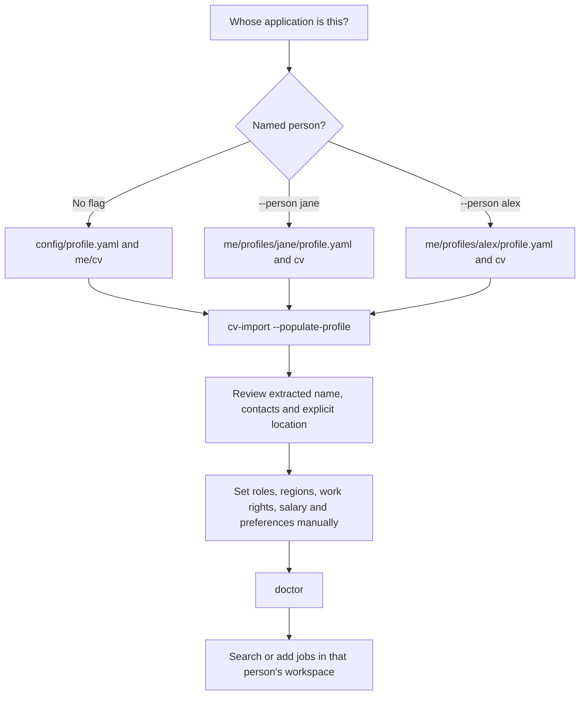
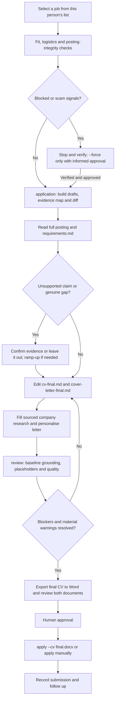
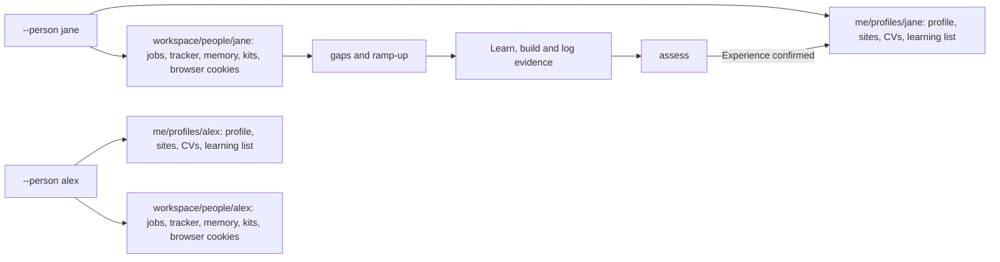

# Application and profile workflows

[Back to setup and the command guide](../README.md).
All commands below use uv; omit `uv run` for an activated pip/venv installation.

## Level 1: select a person and build a baseline



```bash
uv run jobhunt --person jane init
uv run jobhunt --person jane cv-import "path/to/Jane CV.docx" --populate-profile
# Edit me/profiles/jane/profile.yaml and sites.yaml, then:
uv run jobhunt --person jane doctor
uv run jobhunt --person jane daily
uv run jobhunt profiles
```

Alternatively, `profile-from-cv "path/to/cv.docx"` fills a profile directly from a source file, without copying it.
With no file, it uses the selected baseline. It preserves existing nonempty values and reports conflicting fields.
The source file remains where it is; use `cv-import --populate-profile` to keep a local baseline copy.
Only explicit name, email, phone, LinkedIn, GitHub and a clearly formatted header location are extracted.
Scanned PDFs need OCR first. Skills are read from the CV during matching, not guessed into profile preferences.

`--person` is explicit on every invocation (before or after the command). Omitting it returns to the original
single-user setup; there is no sticky "last person". IDs use lowercase letters, digits, `_` and `-`.
`--profile file.yaml` overrides settings only, **not** the workspace: always use `--person` for different people.
Local separation is not access control or encryption; anyone with filesystem access can read these files.

## Level 2: one posting to application documents



```bash
uv run jobhunt --person jane add "https://boards.greenhouse.io/example/jobs/123"
# Or: add --file posting.txt --title "Backend Engineer" --company "Example" --remote
uv run jobhunt --person jane application 1
uv run jobhunt --person jane research 1
```

Open the folder printed by `application`:

| File | Purpose |
|---|---|
| `posting.md`, `fit.md` | Original posting and eligibility/logistics checks |
| `requirements.md` | Recognised posting skills mapped to baseline evidence; manual checks for all other requirements |
| `cv-review.md`, `cv-changes.diff` | Wording/coverage suggestions and exactly what changed |
| `cv-draft.md`, `cv-draft.docx` | Editable tailored CV and Word draft snapshot |
| `cover-letter.md`, `cover-letter.docx` | Companion letter using the same person's achievements |
| `form-answers.md`, `review.md`, `checklist.md` | Known answers, remaining issues and steps to complete |
| `interview-prep.md` | Role-specific preparation |

Company notes are shared only across that person's applications. The baseline is never overwritten by tailoring.
Re-running `application` regenerates draft files; approved `cv-final.md` / `cover-letter-final.md` are preserved.
Save your edits under these final names before regenerating.

Replace `PATH_TO_KIT` below with the printed directory:

```bash
# Edit PATH_TO_KIT/cv-final.md and PATH_TO_KIT/cover-letter-final.md first.
uv run jobhunt --person jane review 1
uv run jobhunt --person jane cv-export "PATH_TO_KIT/cv-final.md" --out "PATH_TO_KIT/cv-final.docx"
uv run jobhunt --person jane apply 1 --cv "PATH_TO_KIT/cv-final.docx"
uv run jobhunt --person jane track list
uv run jobhunt --person jane track followups
```

Editing Markdown does not automatically update Word. Re-export the CV after edits. The cover-letter Word file is
also a draft snapshot; finalise it in Word or paste the approved letter text into the application.
The browser assistant uploads the file passed to `--cv`; without that flag it uses the profile's baseline.
It does not automatically upload the cover letter. Review and provide that letter yourself where requested.
If you apply manually, use `track add <job> applied` or update the existing application ID, not both.

**A perfect match cannot be guaranteed.** Keyword coverage is a heuristic, not a hiring decision. No missing skill,
title, credential or metric is invented. Newly confirmed experience belongs in the baseline only with consent,
then regenerate and review.

## Level 3: storage and learning loop



`JOBHUNT_HOME` changes the workspace root, but named people still get separate `people/<id>/` subdirectories.
Their browser logins, screenshots, research, dashboards, assessments and journals stay in those directories.
Default `.env` notification destinations are not inherited by named people: configure `notify:` individually in
each person's local profile. All personal profile, CV and state directories remain git-ignored.

Put Jane's optional learning list in `me/profiles/jane/learning-resources.yaml` (or `.csv` / `.md`), then:

```bash
uv run jobhunt --person jane gaps
uv run jobhunt --person jane ramp-up --free
uv run jobhunt --person jane ramp-up log Kubernetes --hours 4 --note "Deployed a demo app"
uv run jobhunt --person jane assess Kubernetes
```

Back up `me/`, `config/` and your workspace root securely. Do not commit them or share people's CVs in issues or PRs.
